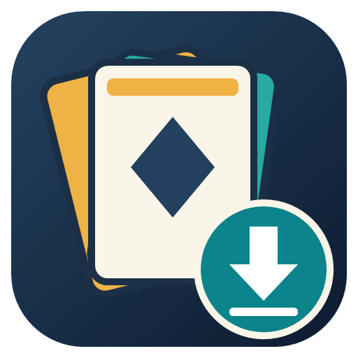

# MTG Forge Deck Importer



A small Windows desktop app that turns a pasted Commander deck list into a saved deck in [Forge](https://github.com/Card-Forge/forge).

**[Download for Windows](https://github.com/Dr-Ake/MTG-Forge-Deck-Importer/releases/latest/download/Forge-Deck-Importer-Windows.zip)** · [All releases](https://github.com/Dr-Ake/MTG-Forge-Deck-Importer/releases)

## Get started

1. Download the Windows ZIP above and extract it to a folder on your desktop.
2. Open **Forge Deck Importer.exe**.
3. Paste your full 100-card list, including its commander.
4. Select the default commander and enter a deck name. For an alphabetical list, choose the commander from the dropdown.
5. Optionally tick other leaders under **Alternate commander choices**.
6. Click **Add to Forge**.

If Forge is already open, finish your game and restart Forge to refresh its deck list. The importer leaves a running game alone.

The EXE includes its own icon. You can create a Windows desktop shortcut to it after extracting the folder.

## What it accepts

Quantities can use spaces or tabs, with or without `x`:

```text
1 Muldrotha, the Gravetide
1x Sol Ring
5x Forest
1x Howlpack Piper // Wildsong Howler
```

This short example illustrates the format; import a complete 100-card deck.

- Trailing backslashes copied from chat are accepted.
- Double-faced and adventure cards can use `Front // Back`; the app saves Forge's correct card name and counts the physical card once.
- Split cards such as `Fire // Ice` retain their combined name.
- Simple headings such as `Commander (1)` and `Lands (36)`, plus Markdown code fences, are accepted.
- Straight and curly apostrophes are accepted.

The app checks the total and matches names against the card database in your installed Forge. Missing or misspelled cards produce an error before saving. It preserves your list instead of substituting cards.

## Alternate commanders

Choose a default commander, then tick other eligible leaders already included in the list. The default is saved in Forge's Commander section; the alternatives stay in Main, so the deck remains at 100 cards.

Before a game, use the **Commander** button on your player panel in Forge. Forge checks which choices can legally lead the deck. Selecting another leader swaps it into the command zone and returns the previous commander to Main for that match. The saved default stays unchanged.

This checklist marks alternate choices for one commander at a time. Simultaneous partner commanders are outside the importer's current scope. The importer checks counts and card availability; Forge checks deck legality, including color identity.

## Finding Forge and saving decks

The app looks for Forge through desktop shortcuts and the common `D:\Forge` location. Use **Choose Forge…** to select another installation folder containing `res\cardsfolder\cardsfolder.zip`.

It reads `forge.profile.properties`, including `userDir` and `decksDir`, to find the correct Commander deck folder. Without an override, that is normally `%APPDATA%\Forge\decks\commander`.

Replacing a deck requires confirmation and keeps a copy of the previous file in `_deck-importer-backups` beside the Commander folder. Give a variant a different deck name to keep both versions.

## Requirements

- Windows with .NET Framework 4.8, provided on current Windows 10/11 systems.
- An existing Forge desktop installation with its card database.

The release is a portable EXE: extract it and run it. There is no installer or additional package download. Deck lists are processed locally; using the app requires no account, server, or internet connection.

Forge is installed separately. The release contains the importer, not the game or its card database.

## Build from source

Use Windows PowerShell or PowerShell on a Windows PC with .NET Framework's C# compiler:

```powershell
./scripts/Build.ps1
./scripts/Test.ps1
./scripts/Package.ps1
```

The build uses Windows Forms and the .NET Framework libraries already on the machine. Build and package output folders are excluded from source control. See the scripts for output paths and options.

Source code is in `src/`, the icon and preview are in `assets/`, and the deterministic icon builder is in `tools/`.

## Validation

The built-in tests cover list parsing, card-name aliases, double-faced and split cards, alternate commander metadata, 100-card preservation, filename handling, replacement backups, and Forge profile paths.

The initial release was also checked against six complete deck lists and the installed Forge `2.0.16-SNAPSHOT-11.11` Commander selection code. Muldrotha, Sidisi, and Teval alternate choices were verified to preserve 99 main cards plus one commander. These checks do not establish compatibility with every past or future Forge release.

## Report a problem

[Open an issue](https://github.com/Dr-Ake/MTG-Forge-Deck-Importer/issues) with your Forge version, the format you pasted, and the error message. Share only deck lists and details you are comfortable making public.

This is an independent utility for Forge and is not affiliated with Wizards of the Coast or the Forge project.
